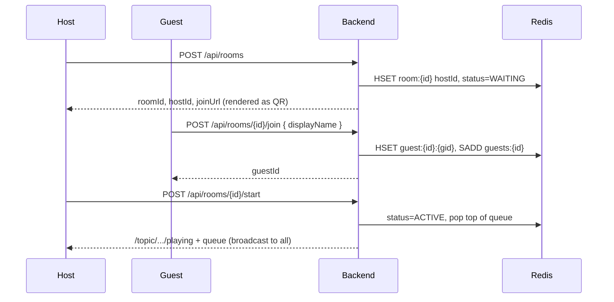
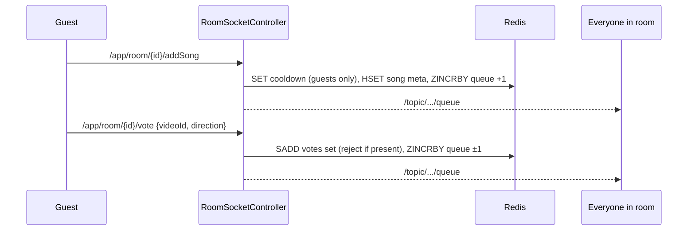
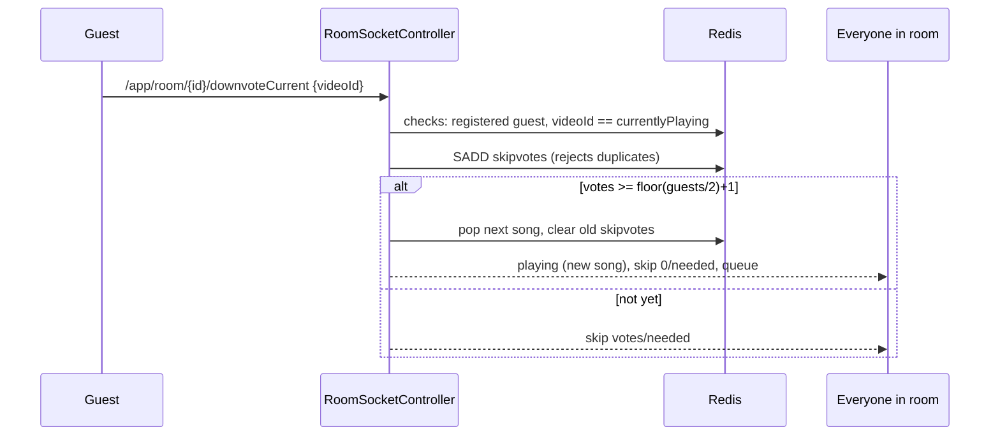
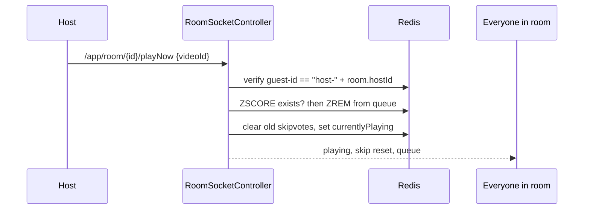
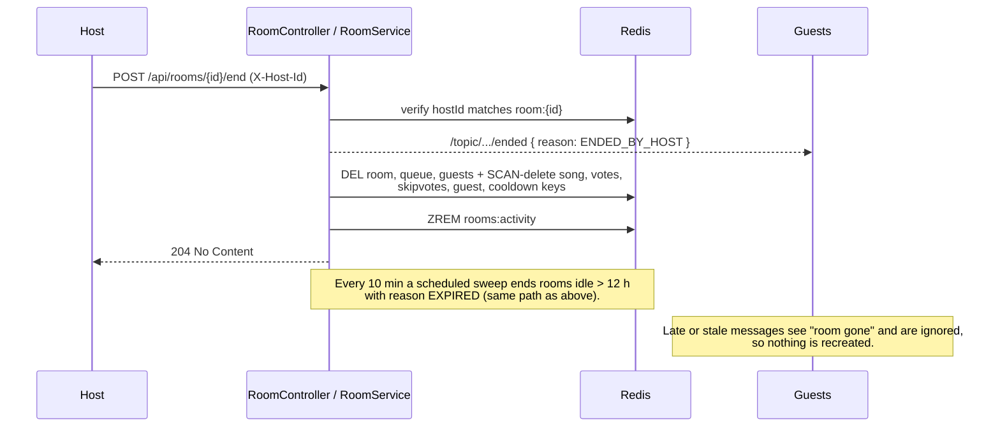

# Pub Jukebox

A real-time, room-based jukebox for pubs, parties and shared spaces. The **host** plays music on one screen; **guests** scan a QR code, search YouTube from their phones, add songs to a shared queue, vote on what plays next, and can collectively skip a song they don't like.

> **Stack:** React 18 · Vite 5 · Tailwind CSS 3 · Spring Boot 3.2 (Java 17) · Redis · STOMP over WebSocket · YouTube Data API v3

---

## Table of contents

1. [Features](#1-features)
2. [Tech stack](#2-tech-stack)
3. [System design](#3-system-design)
   - [Architecture](#31-architecture)
   - [Components](#32-components)
   - [Room lifecycle](#33-room-lifecycle)
   - [Data model (Redis)](#34-data-model-redis)
   - [API reference](#35-api-reference)
   - [Key flows](#36-key-flows)
   - [Design decisions](#37-design-decisions)
   - [Security, scaling and limitations](#38-security-scaling-and-limitations)
4. [Getting started](#4-getting-started)
5. [Using the app](#5-using-the-app)
6. [Theming](#6-theming)
7. [Project structure](#7-project-structure)
8. [Testing](#8-testing)
9. [Troubleshooting](#9-troubleshooting)
10. [Ideas for the future](#10-ideas-for-the-future)

---

## 1. Features

### Host

| Feature | Details |
|---|---|
| **Create a room** | One click creates a room with a 5-character code (e.g. `K7QWM`), a QR code and a join URL. |
| **Resume a session** | The host session is stored in `localStorage` (`pj_host_session`), so a refresh offers **Resume** instead of losing the room. |
| **Start the party** | A deliberate click starts playback; the click also satisfies the browser's autoplay policy. The top-voted song starts playing. |
| **Built-in YouTube player** | Plays the current song via the YouTube iframe player. When a track ends (or errors), the host client asks the server for the next one. |
| **Search and add songs** | Search YouTube (music category) and add songs. The host is exempt from the add-song cooldown. |
| **Play any queued song now** | Every queue row has a ▶ button that plays that song immediately. It is host-only (verified on the server) and enabled once the party has started. |
| **Skip** | Skip the current song at any time. |
| **See skip votes** | The Now Playing panel shows `votes/needed downvotes to skip` while guests are downvoting. |
| **Join as a guest** | Enter a room code on the landing page to join another room as a guest. |
| **End party** | After a confirmation prompt, **closes the room for everyone**: guests are notified and disconnected, and the queue, songs, votes, guest list and room code are deleted from Redis. |

### Guest

| Feature | Details |
|---|---|
| **Join by QR / link** | Scan the QR code (or open `/join/<CODE>`), pick a display name, and you're in. Identity persists in `localStorage` (`pj_guest_<room>`). |
| **Search and add songs** | Search YouTube and add a song to the shared queue. Each guest has a 5-minute cooldown between adds. |
| **Vote on queued songs** | 👍 / 👎 on any queued song; the queue is ordered by net score. Each guest can cast one up and one down vote per song. |
| **Downvote the playing song** | 👎 on the Now Playing card. If a **majority** of guests downvote, the song is skipped and the next one plays. |
| **Live updates** | The queue, now-playing track and skip progress update instantly for everyone over WebSocket. |
| **Clear feedback** | Friendly toasts for the cooldown, duplicate votes, and connection state. |
| **Party-over screen** | When the host ends the party (or the room expires), guests see a "The party's over" screen instead of a dead UI. Guests who reload or arrive late are told the room is closed. |

### Rules at a glance

| Rule | Behaviour |
|---|---|
| Queue ordering | Highest net score first. Equal scores are ordered by Redis sorted-set order (reverse lexicographic video ID), **not** by time added. |
| Adding a song already queued | Counts as an upvote (+1) rather than creating a duplicate. |
| Add-song cooldown | 5 minutes per guest per room (host exempt). The cooldown is consumed even when the add was a duplicate. |
| Vote debounce | One up and one down vote per guest per song. Repeats are rejected with an `ALREADY_VOTED` message. |
| Skip majority | `needed = floor(guests / 2) + 1`, where `guests` is the number of guests who joined the room. |
| Skip with an empty queue | The room goes **IDLE** (nothing plays) until someone adds a song and the host advances. |
| Skip vote reset | Skip votes are cleared whenever the playing song changes (end, skip, majority skip, or play-now). |
| Host-only actions | `playNow` and **ending the party** are verified against the room's stored `hostId`; guests receive `NOT_HOST` / HTTP `403`. |
| Ending a room | Deletes every Redis key belonging to the room and broadcasts `ended`. Later calls from stale clients are ignored and can't recreate the room. |
| Idle expiry | A room with no activity for **12 hours** (configurable) is closed automatically, exactly like "End party". Any join, add, vote, skip or reconnect counts as activity. |

---

## 2. Tech stack

| Layer | Technology |
|---|---|
| Frontend | React 18, Vite 5, Tailwind CSS 3, React Router 6, Axios, `@stomp/stompjs` 7, `react-youtube`, `qrcode.react`, `lucide-react`, Outfit (self-hosted via `@fontsource-variable/outfit`) |
| Backend | Spring Boot 3.2.3, Java 17, Spring Web, Spring WebSocket (STOMP, simple in-memory broker), Spring Data Redis, Jackson |
| Data | Redis (sorted sets, hashes, sets, TTL keys) |
| External | YouTube Data API v3 (`search.list`) |

---

## 3. System design

### 3.1 Architecture

```
   Host browser  (/host)                    Guest phones  (/join/:room, /guest/:room)
   React + YouTube iframe player            React
          │                                        │
          │  REST  (/api/*)  via Vite proxy        │  REST  (/api/*)  via Vite proxy
          │  STOMP over native WebSocket           │  STOMP over native WebSocket
          │  ws://<host>:8080/stomp                │  ws://<host>:8080/stomp
          └───────────────────┬────────────────────┘
                              ▼
              ┌──────────────────────────────────┐
              │   Spring Boot backend  :8080     │
              │                                  │
              │  REST controllers                │
              │   RoomController, GuestController│
              │   SearchController               │
              │  STOMP controller                │
              │   RoomSocketController           │
              │  Services                        │
              │   Queue · Vote · Guest ·         │
              │   RateLimit · YouTube            │
              │  Simple broker  /topic/**        │
              └───────────┬───────────┬──────────┘
                          ▼           ▼
                       Redis     YouTube Data API v3
              (rooms, queue,     (search only, cached
               votes, guests)     in Redis for 3 min)
```

**Why this shape:** the server is the single source of truth for each room. Clients never compute queue order or skip results themselves. They send intents (add, vote, downvote, play-now, next) and render whatever state the server broadcasts.

### 3.2 Components

**Backend** (`com.pubjukebox`)

| Package / class | Responsibility |
|---|---|
| `controller.RoomController` | `POST /api/rooms` (create), `GET /api/rooms/{id}` (state snapshot), `POST /api/rooms/{id}/start`, `POST /api/rooms/{id}/end`. |
| `controller.GuestController` | `POST /api/rooms/{id}/join`. Registers a guest and returns a server-issued UUID. |
| `controller.SearchController` | `GET /api/search?q=` delegating to `YouTubeService`. |
| `controller.RoomSocketController` | All real-time actions: `subscribe`, `addSong`, `vote`, `next`, `downvoteCurrent`, `playNow`. Owns the shared `playSong()` transition that every "change what's playing" path uses. |
| `service.QueueService` | Sorted-set queue: add, list, `popNext`, `popSpecific`. |
| `service.VoteService` | Up/down vote debounce on queued songs and skip-vote tracking for the playing song. |
| `service.GuestService` | Guest registration, display names, guest count, membership checks. |
| `service.RoomService` | Room existence and host checks, activity tracking, **`endRoom()`** (notify + delete all room keys), and the scheduled sweep that closes idle rooms. |
| `service.RateLimitService` | 5-minute add-song cooldown per guest. |
| `service.YouTubeService` | Calls YouTube `search.list`, parses results, caches them. |
| `config.WebSocketConfig` | STOMP endpoints `/stomp` (native) and `/ws` (SockJS fallback), broker `/topic`, app prefix `/app`. |
| `config.RedisConfig`, `CorsConfig` | String-only Redis template; CORS for `/api/**`. |
| `exception.*` | `RateLimitException` and a global exception handler. |
| `model.dto.*` | Immutable records for requests, responses and broadcasts. |

**Frontend** (`frontend/src`)

| File | Responsibility |
|---|---|
| `App.jsx` | Router and the global grid-background shell. Routes: `/` → `/host`, `/host`, `/join/:roomId`, `/guest/:roomId`. |
| `pages/HostView.jsx` | Landing (create / resume / join), host dashboard, player, search, queue. |
| `pages/JoinView.jsx` | Name entry, joins the room via REST, saves the guest session. |
| `pages/GuestView.jsx` | Guest experience: now playing + downvote, search, queue voting. |
| `hooks/useRoomSocket.js` | One hook that owns the STOMP connection and exposes `queue`, `nowPlaying`, `skipStatus`, `connected`, and the actions `addSong`, `vote`, `next`, `downvoteCurrent`, `playNow`. |
| `components/Card.jsx` | Reusable accent card (bold text left, icon right, `↗` arrow and lift/shadow hover when clickable). |
| `components/ConfirmDialog.jsx` | Modal used to confirm the destructive "End party" action. |
| `lib/api.js` | Axios wrapper for the REST endpoints. |
| `lib/hostSession.js`, `lib/guestSession.js` | `localStorage` session persistence. |
| `theme.js`, `index.css` | Theme switch and design tokens (see [Theming](#6-theming)). |

### 3.3 Room lifecycle

A room's `status` field moves through three states:

```
            POST /start                      queue empty after a
 WAITING ─────────────────► ACTIVE ◄──────────────────────────────┐
 (created)                  (playing)        next / skip / play-now │
                               │                                    │
                               │ no song left to play               │
                               ▼                                    │
                             IDLE ──── host advances with a song ───┘
```

- `WAITING`: room exists, guests can join and queue songs, nothing is playing yet.
- `ACTIVE`: a song is playing (`currentlyPlaying` holds its video ID).
- `IDLE`: the queue ran out; `currentlyPlaying` is empty.

From **any** state, ending the party (host) or going 12 hours without activity (sweeper) **closes** the room: clients receive `ended`, every key for the room is deleted, and the room code stops existing (`GET` / `join` / `start` return `404`).

Every transition that changes the playing song goes through one method, `RoomSocketController.playSong()`. It clears the previous song's skip votes, updates `room:{id}`, broadcasts `playing`, `skip` and `queue`, so the paths can't drift apart.

### 3.4 Data model (Redis)

All values are strings (`StringRedisSerializer`). Per-room keys don't carry their own TTL; instead the room as a whole is deleted when it ends or goes idle (see `rooms:activity`). Keys marked with a TTL also expire on their own.

| Key | Type | TTL | Contents |
|---|---|---|---|
| `room:{roomId}` | Hash | none | `hostId`, `status` (`WAITING`/`ACTIVE`/`IDLE`), `currentlyPlaying` |
| `queue:{roomId}` | Sorted set | none | member = `videoId`, score = net votes |
| `song:{roomId}:{videoId}` | Hash | none | `title`, `thumbnail`, `channelTitle`, `addedBy` |
| `votes:{roomId}:video:{videoId}` | Set | none | `"{guestId}:up"` / `"{guestId}:down"` entries (vote debounce for queued songs) |
| `skipvotes:{roomId}:{videoId}` | Set | none | guest IDs who downvoted the **currently playing** song |
| `guests:{roomId}` | Set | none | every guest ID that joined |
| `guest:{roomId}:{guestId}` | Hash | 6 h | `displayName` |
| `cooldown:{roomId}:user:{guestId}` | String | 300 s | add-song cooldown marker |
| `search:{normalized query}` | String (JSON) | 180 s | cached YouTube search results |
| `rooms:activity` | Sorted set | none | member = `roomId`, score = last-activity timestamp (ms). The sweeper closes rooms whose score is older than the idle limit. |

**Why a separate `skipvotes` set?** When a song starts playing it is *removed* from the queue sorted set. The normal vote path increments the queue score, which would silently re-add the playing song, so downvotes on the playing song live in their own set that is cleared when the song changes.

### 3.5 API reference

#### REST (`/api`)

| Method & path | Body | Success response | Errors |
|---|---|---|---|
| `POST /rooms` | — | `{ roomId, hostId, joinUrl }` | — |
| `GET /rooms/{roomId}` | — | `{ roomId, status, nowPlaying, queue[], guestCount }` | `404` unknown room |
| `POST /rooms/{roomId}/start` | — | `200`. Sets `ACTIVE`, pops and broadcasts the first song. | `404` unknown/closed room |
| `POST /rooms/{roomId}/end` | header `X-Host-Id: <hostId>` | `204`. Broadcasts `ended`, then deletes all room data. | `404` unknown/closed room, `403` missing or wrong host id |
| `POST /rooms/{roomId}/join` | `{ displayName }` | `{ guestId, displayName, roomId }` | `404` unknown room, `400` blank name |
| `GET /search?q=` | — | `[{ videoId, title, thumbnail, channelTitle }]` | `400` blank query |

#### STOMP (WebSocket)

Connect to `ws://<server>:8080/stomp` with the connect header `guest-id: <id>`. Hosts use `host-<hostId>`; guests use the UUID returned by `join`. Send messages to the **application destinations**; listen on the **topics**.

**Send** (prefix `/app/room/{roomId}/…`)

| Destination | Payload | Who | Effect |
|---|---|---|---|
| `subscribe` | `{}` | anyone | Server broadcasts the current queue, playing song and skip status. Sent on every connect, so reloads resync. If the room is closed, the server answers with `ended` instead. |
| `addSong` | `{ videoId, title, thumbnail, channelTitle }` | guest / host | Applies cooldown (guests), stores metadata, `ZINCRBY +1`, broadcasts the queue. |
| `vote` | `{ videoId, direction }` (`+1` / `-1`) | guest | Debounced per guest and direction; broadcasts the queue. |
| `next` | `{}` | host client | Plays the top-scored song (or goes `IDLE`). Sent by the host player on end/error and by the Skip button. |
| `downvoteCurrent` | `{ videoId }` | guest | Counts a skip vote. At majority, behaves like `next`. Ignored if `videoId` isn't the playing song, or the sender is the host or an unregistered guest. |
| `playNow` | `{ videoId }` | host only | Removes the chosen song from the queue and plays it immediately. |

**Subscribe** (topics `/topic/room/{roomId}/…`)

| Topic | Payload |
|---|---|
| `queue` | `[{ videoId, title, thumbnail, channelTitle, addedBy, score }]` (highest score first) |
| `playing` | `{ videoId, title, thumbnail, empty }` (`empty: true` when idle) |
| `skip` | `{ videoId, votes, required }` (`videoId` is `""` when nothing is playing) |
| `ended` | `{ reason }` where reason is `ENDED_BY_HOST`, `EXPIRED`, or `ENDED` (room was already closed when you connected). Clients stop reconnecting and show the party-over screen. |
| `error` | `{ guestId, code, message }`. Broadcast to the room, so clients show only messages whose `guestId` is their own. Codes: `RATE_LIMIT`, `ALREADY_VOTED`, `NOT_HOST`, `NOT_IN_QUEUE`. |

### 3.6 Key flows

**Create, join and start**



**Add a song and vote**



**Majority downvote skips the song**



**Host plays a song now**



**Host ends the party (or the room goes idle)**



**Track ends.** The host's YouTube player fires `onEnd` / `onError` → host client sends `next` → server pops the top song and broadcasts. (Playback is driven by the host's browser, which is the only client that actually knows when audio finishes.)

### 3.7 Design decisions

| Decision | Rationale |
|---|---|
| **Redis sorted set as the queue** | `ZINCRBY` makes "add" and "upvote" the same atomic operation, and ordering by score is built in. |
| **Server broadcasts full snapshots** | The queue is small; sending the whole list after each change keeps clients stateless and trivially consistent after reconnects. |
| **Native WebSocket, not SockJS** | SockJS had cross-origin trouble through the Vite proxy. The client connects straight to `ws://<hostname>:8080/stomp`, using `window.location.hostname` so LAN phones work too. The `/ws` SockJS endpoint remains but is unused. |
| **`ZREVRANGE` + `ZREM` instead of `ZPOPMAX`** | Works on older Redis servers (`ZPOPMAX` needs Redis 5.0+). The pair is not atomic, which is acceptable for a single-instance, single-host deployment. |
| **Host-driven "next"** | Only the host's browser knows when a video ends; this avoids server-side timers and duration lookups. |
| **Host identity = `host-` + `hostId`** | The secret `hostId` is returned only to the room creator, so `playNow` can be checked against the stored value. |
| **Strict-majority skip, derived at vote time** | `floor(n/2)+1` is computed from the live guest count each time, so no counters can go stale. |
| **Search cache (3 min), submit-only client search** | `search.list` costs 100 quota units per call; the default 10,000/day allows ~100 uncached searches. Clients search only on Enter/button (never per keystroke) and cancel any in-flight request. |
| **CSS-variable theme** | One `THEME` constant switches the whole look; see [Theming](#6-theming). |

### 3.8 Security, scaling and limitations

This is built for a trusted local venue, not the open internet. Known trade-offs:

**Security**

- **No real authentication.** Guest identity is a server-issued UUID in `localStorage`, sent as the `guest-id` STOMP header, which a client could forge. `playNow` is protected by the host check, but **`next` is not**: any connected client can send it and skip a song.
- **Open CORS / WebSocket origins** (`*`) for convenience on a LAN.
- **API key hygiene.** The backend reads `YOUTUBE_API_KEY` from the environment or a git-ignored `.env` file (see [Configuration](#configuration)). There is no default key in the code, and the app refuses to start without one. Restrict your key in the Google Cloud Console (API restriction to YouTube Data API v3).
- Display names are limited to 30 characters in the UI only; the server only rejects blank names.

**Scaling**

- **Single instance only.** Spring's simple broker is in-memory and doesn't fan out across servers. Scaling out needs an external STOMP relay (e.g. RabbitMQ) or a Redis pub/sub bridge.
- **Queue pop is not atomic** (`ZREVRANGE` then `ZREM`); fine for one server, would need a Lua script/`ZPOPMAX` for many.

**Functional limitations**

- **Guest count only grows.** There is no presence tracking, so guests who leave still count towards the skip majority, making skips harder as the night goes on.
- **Ending a room is permanent.** There is no undo or archive; the queue and room code are deleted. A host who simply closes their browser tab (without ending) leaves the room open until it goes idle for 12 hours.
- **Equal-score songs** are ordered by video ID, not first-come-first-served.
- **Room codes** (5 chars from a 32-character alphabet that excludes `I`, `O`, `0`, `1`) are random with no collision check.
- **YouTube quota** is the main external limit (see above).

---

## 4. Getting started

### Prerequisites

| Tool | Version |
|---|---|
| Java | 17+ |
| Maven | 3.8+ |
| Node.js | 18+ |
| Redis | Any version supporting sorted sets, hashes and key expiry. No 5.0+ commands are required. |
| YouTube Data API v3 key | From the Google Cloud Console |

### 1. Start Redis

```bash
# Docker
docker run -d -p 6379:6379 redis:7-alpine
# …or use a locally installed Redis / Windows service on port 6379
```

### 2. Configure and run the backend

Copy the example env file in the project root and add your YouTube API key:

```bash
cp .env.example .env        # Windows PowerShell: Copy-Item .env.example .env
# then edit .env and set YOUTUBE_API_KEY
```

`.env` is git-ignored and is picked up automatically by the backend. Real environment variables (`export YOUTUBE_API_KEY=...`) also work and take precedence.

```bash
cd backend
mvn spring-boot:run
```

The API and WebSocket endpoint are served at `http://localhost:8080`.

### 3. Run the frontend

```bash
cd frontend
npm install
npm run dev -- --host
```

The app is served at `http://localhost:5173`. (`--host` also exposes it on your LAN for phones.)

### 4. Let phones join over Wi-Fi

The QR code encodes `APP_BASE_URL`, which defaults to `http://localhost:5173`, and `localhost` doesn't work from a phone. Set it in `.env` to the host machine's LAN address before starting the backend:

```bash
APP_BASE_URL=http://192.168.1.20:5173     # your machine's LAN IP
```

Phones connect to the Vite server on port **5173** *and* straight to the backend WebSocket on port **8080**, so allow both ports through the host machine's firewall.

### Configuration

| Variable | Default | Description |
|---|---|---|
| `YOUTUBE_API_KEY` | *(none, required)* | YouTube Data API v3 key. Set it in `.env`. |
| `REDIS_HOST` | `localhost` | Redis host |
| `REDIS_PORT` | `6379` | Redis port |
| `APP_BASE_URL` | `http://localhost:5173` | Base URL used to build the QR/join link |
| `ROOM_IDLE_HOURS` | `12` | Close a room after this many hours without activity |
| `ROOM_CLEANUP_INTERVAL_MS` | `600000` | How often the idle-room sweep runs (10 min) |

Other settings live in `backend/src/main/resources/application.yml` (server port `8080`, YouTube `max-results: 10`, debug logging for `com.pubjukebox`).

---

## 5. Using the app

1. Open `http://localhost:5173` — you land on the **Host** page.
2. Click **Start a Room**. A room code and QR code appear.
3. Guests scan the QR code, enter a display name and join.
4. Anyone can search and add songs; guests vote with 👍 / 👎 on queued songs.
5. Click **Start the Party**. The top-voted song starts playing on the host screen.
6. While it plays:
   - Guests can 👎 the song. Once a majority has, it's skipped automatically.
   - The host can press **Skip**, or hit ▶ next to any queued song to play it right now.
7. When a song ends, the next-highest-scored song plays automatically.
8. When the night is over, click **End Party** and confirm. The room closes for everyone and guests see a "The party's over" screen. (A room nobody touches for 12 hours also closes itself.)

---

## 6. Theming

The whole look is controlled by **one setting** in `frontend/src/theme.js`:

```js
export const THEME = 'lime'   // 'lime' | 'cyan'
```

Themes are defined in `frontend/src/index.css` under **Themes**. Each sets the accent colour (as RGB channels) and the grid-line opacity; cards, buttons, badges and the graph-paper background all derive from it:

```css
[data-theme='lime'] { --color-accent: 132 255 0;   --grid-alpha: 0.25; }
[data-theme='cyan'] { --color-accent: 166 227 233; --grid-alpha: 0.55; }
```

To add a theme, copy a block, give it a new name and colour, and set `THEME` to it. A theme can also override any base token (`--color-canvas`, `--color-ink`, `--color-muted`, `--radius-card`, shadows…).

**Design language:** neo-brutalist, high-contrast. Off-white canvas with a CSS-only graph grid, pure-black text and 2 px borders, 18 px card radius, ultra-bold geometric headings (Outfit, weight 800–900), and a sharp `4px 4px 0 #000` offset shadow plus a 4 px lift on hover for clickable cards.

---

## 7. Project structure

```
pub-jukebox/
├── README.md
├── backend/
│   ├── pom.xml
│   └── src/main/
│       ├── resources/application.yml
│       └── java/com/pubjukebox/
│           ├── PubJukeboxApplication.java
│           ├── config/        CorsConfig, RedisConfig, WebSocketConfig
│           ├── controller/    RoomController, GuestController,
│           │                  SearchController, RoomSocketController
│           ├── service/       QueueService, VoteService, GuestService,
│           │                  RoomService, RateLimitService, YouTubeService
│           ├── exception/     RateLimitException, GlobalExceptionHandler
│           └── model/dto/     NowPlaying, QueueItem, SkipStatus, SongResult,
│                              AddSongMessage, VoteMessage, SkipVoteMessage,
│                              PlayNowMessage, ErrorMessage, Create/Join DTOs …
└── frontend/
    ├── index.html, vite.config.js, tailwind.config.js, postcss.config.js
    └── src/
        ├── main.jsx, App.jsx, theme.js, index.css
        ├── pages/         HostView, JoinView, GuestView
        ├── components/    Card, ConfirmDialog
        ├── hooks/         useRoomSocket
        └── lib/           api, hostSession, guestSession
```

---

## 8. Testing

There is no automated test suite committed to the repository yet (only the Spring Boot test starter dependency). The real-time logic (majority skip, duplicate-vote rejection, stale-vote handling, host-only `playNow`, empty-queue idling, host-only end-party with full Redis cleanup, no resurrection by stale clients, and idle-room expiry) was verified with an end-to-end script that drives a running backend through the real REST and STOMP endpoints. Turning that into a committed integration test (Testcontainers + Redis) is a good next step.

---

## 9. Troubleshooting

| Symptom | Cause / fix |
|---|---|
| Frontend shows a blank page after changing `tailwind.config.js` | Vite caches the Tailwind config. Restart `npm run dev`. |
| Phones can't open the QR link or stay "Offline" | Set `APP_BASE_URL` to the LAN IP, run Vite with `--host`, and allow ports 5173 and 8080 through the firewall. |
| `ERR unknown command ZPOPMAX` | You're on an old Redis. The current code already avoids `ZPOPMAX`; make sure you're on the latest code. |
| Search returns nothing | Check `YOUTUBE_API_KEY` and your daily quota. The service returns an empty list on any API error. |
| `Failed to create room — is the backend running?` | Start the backend on port 8080 and make sure Redis is reachable. |
| `mvn spring-boot:run` says "No plugin found for prefix 'spring-boot'" | You ran it outside `backend/`. |
| Music doesn't autoplay | Browsers require a user gesture; click **Start the Party** on the host screen. |

---

## 10. Ideas for the future

- Restrict `next` to the host and add lightweight guest tokens.
- Track guest presence so the skip majority reflects who's actually here.
- First-come-first-served tie-breaking for equal scores.
- External STOMP broker for multi-instance deployments.
- Committed integration tests (Testcontainers) and CI.
